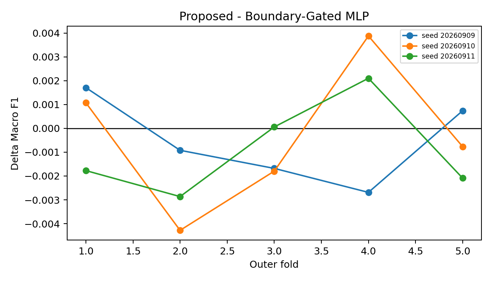
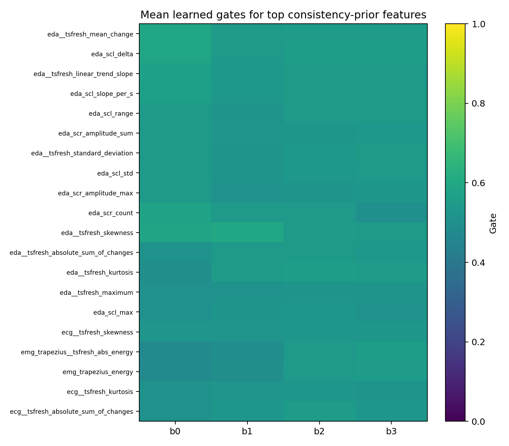
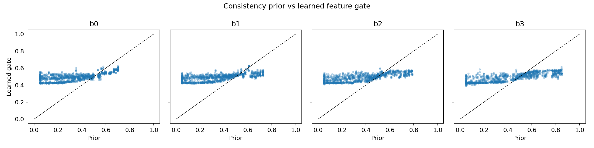

# Phase 7.0 Consistency-Regularized Boundary-Gated Ordinal Network

Run date: 2026-10-18T08:31:34.656636+00:00

## Design and leakage control

- Input: all 72 retained ECG/EDA/trapezius-EMG features; no facial/video data.
- Outer evaluation reuses the exact Phase 3 five subject-independent folds.
- Imputation, scaling, consistency prior, architecture/lambda selection, and epoch selection are fit only inside the current outer-training subjects.
- Four conditional transition probabilities are multiplied to produce monotone cumulative probabilities `P(y>b)`; class probabilities are therefore non-negative and sum to one by construction.
- Ordinal loss is the equal-weight mean of class-balanced cumulative-boundary BCE and NLL on the induced valid five-class probabilities. This prevents a boundary-discriminative model from silently collapsing intermediate-class predictions.
- All three neural variants share the selected architecture, optimizer, and final epoch budget within each outer fold; Proposed differs from Boundary-Gated MLP only through the selected consistency penalty.
- The consistency prior is a single direction-aware effect statistic: robust subject-level median shifts are winsorized, opposing directions cancel in the signed mean, and negligible effects are shrunk. It does not reuse Phase 7.1's combined reliability formula.
- The Phase 3 flat XGBoost reference is reused without retraining. It used the 59-feature de-duplicated `combined_unique` set; neural models use the requested full 72-feature representation, so that comparison is contextual rather than a pure architecture ablation.
- The archived Phase 3 XGBoost output contains hard predictions but no saved probabilities. It is included in multiclass metrics, but omitted from cumulative-boundary and adjacent-pair AUC tables rather than reconstructing unsupported scores.
- Core controlled contrast for the inductive bias is Proposed vs Boundary-Gated MLP, which differs only by the gate-to-prior penalty.

## Overall results

| method | seeds | macro F1 | balanced accuracy | MAE | QWK | severe error rate |
|---|---:|---:|---:|---:|---:|---:|
| Flat XGBoost (Phase 3) | 1 | 0.3052 | 0.3324 | 1.1476 | 0.4691 | 0.3222 |
| ordinal_mlp | 3 | 0.2238 +/- 0.0029 | 0.3245 +/- 0.0024 | 1.3450 +/- 0.0031 | 0.4104 +/- 0.0009 | 0.4021 +/- 0.0021 |
| boundary_gated_mlp | 3 | 0.2180 +/- 0.0033 | 0.3241 +/- 0.0011 | 1.3575 +/- 0.0082 | 0.4062 +/- 0.0035 | 0.4062 +/- 0.0039 |
| proposed | 3 | 0.2174 +/- 0.0037 | 0.3238 +/- 0.0011 | 1.3603 +/- 0.0060 | 0.4045 +/- 0.0020 | 0.4069 +/- 0.0032 |

## Paired outer-fold comparisons

Deltas are treatment minus control after averaging random seeds within each outer fold. For MAE and severe error rate, negative is better. CIs are paired bootstrap intervals over the five outer folds and are descriptive because n=5.

| treatment | control | metric | mean delta | 95% CI | positive folds |
|---|---|---|---:|---:|---:|
| ordinal_mlp | flat_xgboost_reference | macro_f1 | -0.0814 | [-0.0940, -0.0638] | 0/5 |
| ordinal_mlp | flat_xgboost_reference | balanced_accuracy | -0.0077 | [-0.0148, -0.0005] | 1/5 |
| ordinal_mlp | flat_xgboost_reference | mae | 0.1969 | [0.1598, 0.2237] | 5/5 |
| ordinal_mlp | flat_xgboost_reference | qwk | -0.0584 | [-0.0745, -0.0443] | 0/5 |
| ordinal_mlp | flat_xgboost_reference | severe_error_rate | 0.0797 | [0.0671, 0.0902] | 5/5 |
| boundary_gated_mlp | ordinal_mlp | macro_f1 | -0.0058 | [-0.0081, -0.0031] | 0/5 |
| boundary_gated_mlp | ordinal_mlp | balanced_accuracy | -0.0004 | [-0.0022, 0.0020] | 1/5 |
| boundary_gated_mlp | ordinal_mlp | mae | 0.0123 | [0.0064, 0.0185] | 5/5 |
| boundary_gated_mlp | ordinal_mlp | qwk | -0.0040 | [-0.0066, -0.0014] | 1/5 |
| boundary_gated_mlp | ordinal_mlp | severe_error_rate | 0.0041 | [0.0010, 0.0068] | 4/5 |
| proposed | boundary_gated_mlp | macro_f1 | -0.0006 | [-0.0018, 0.0005] | 2/5 |
| proposed | boundary_gated_mlp | balanced_accuracy | -0.0003 | [-0.0011, 0.0004] | 2/5 |
| proposed | boundary_gated_mlp | mae | 0.0028 | [0.0010, 0.0054] | 5/5 |
| proposed | boundary_gated_mlp | qwk | -0.0017 | [-0.0036, -0.0006] | 0/5 |
| proposed | boundary_gated_mlp | severe_error_rate | 0.0007 | [0.0002, 0.0010] | 4/5 |

### Core comparison at subject level

Subject metrics are first averaged over seeds, then paired by subject. The bootstrap resamples the 87 held-out subjects. Positive still means treatment minus control, so positive MAE/severe-error deltas are worse.

| metric | mean subject delta | 95% CI | positive subjects |
|---|---:|---:|---:|
| macro_f1 | -0.0007 | [-0.0023, 0.0009] | 38/87 |
| balanced_accuracy | -0.0003 | [-0.0015, 0.0008] | 27/87 |
| mae | 0.0029 | [-0.0002, 0.0059] | 39/87 |
| qwk | -0.0017 | [-0.0034, 0.0000] | 33/87 |
| severe_error_rate | 0.0007 | [-0.0007, 0.0018] | 39/87 |

### Fold/seed stability: Macro F1

| method | fold | mean over seeds | seed SD |
|---|---:|---:|---:|
| boundary_gated_mlp | 1 | 0.2456 | 0.0028 |
| boundary_gated_mlp | 2 | 0.2143 | 0.0039 |
| boundary_gated_mlp | 3 | 0.2081 | 0.0111 |
| boundary_gated_mlp | 4 | 0.2073 | 0.0071 |
| boundary_gated_mlp | 5 | 0.2119 | 0.0031 |
| ordinal_mlp | 1 | 0.2516 | 0.0041 |
| ordinal_mlp | 2 | 0.2148 | 0.0034 |
| ordinal_mlp | 3 | 0.2141 | 0.0066 |
| ordinal_mlp | 4 | 0.2161 | 0.0021 |
| ordinal_mlp | 5 | 0.2198 | 0.0079 |
| proposed | 1 | 0.2459 | 0.0023 |
| proposed | 2 | 0.2116 | 0.0026 |
| proposed | 3 | 0.2070 | 0.0101 |
| proposed | 4 | 0.2084 | 0.0078 |
| proposed | 5 | 0.2112 | 0.0035 |

### Per-class performance

| method | class | F1 mean +/- SD | recall mean +/- SD |
|---|---|---:|---:|
| boundary_gated_mlp | BL1 | 0.4385 +/- 0.0118 | 0.8326 +/- 0.0397 |
| boundary_gated_mlp | PA1 | 0.0575 +/- 0.0275 | 0.0333 +/- 0.0170 |
| boundary_gated_mlp | PA2 | 0.0447 +/- 0.0261 | 0.0258 +/- 0.0165 |
| boundary_gated_mlp | PA3 | 0.0471 +/- 0.0323 | 0.0278 +/- 0.0202 |
| boundary_gated_mlp | PA4 | 0.4994 +/- 0.0230 | 0.7016 +/- 0.0612 |
| flat_xgboost_reference | BL1 | 0.4450 +/- 0.0199 | 0.5881 +/- 0.0549 |
| flat_xgboost_reference | PA1 | 0.2270 +/- 0.0289 | 0.2086 +/- 0.0327 |
| flat_xgboost_reference | PA2 | 0.1266 +/- 0.0249 | 0.0917 +/- 0.0225 |
| flat_xgboost_reference | PA3 | 0.2305 +/- 0.0166 | 0.2077 +/- 0.0271 |
| flat_xgboost_reference | PA4 | 0.4942 +/- 0.0285 | 0.5651 +/- 0.0358 |
| ordinal_mlp | BL1 | 0.4411 +/- 0.0126 | 0.8268 +/- 0.0340 |
| ordinal_mlp | PA1 | 0.0633 +/- 0.0327 | 0.0377 +/- 0.0215 |
| ordinal_mlp | PA2 | 0.0561 +/- 0.0247 | 0.0328 +/- 0.0152 |
| ordinal_mlp | PA3 | 0.0564 +/- 0.0232 | 0.0335 +/- 0.0152 |
| ordinal_mlp | PA4 | 0.4995 +/- 0.0232 | 0.6922 +/- 0.0546 |
| proposed | BL1 | 0.4377 +/- 0.0113 | 0.8334 +/- 0.0387 |
| proposed | PA1 | 0.0576 +/- 0.0269 | 0.0333 +/- 0.0167 |
| proposed | PA2 | 0.0413 +/- 0.0288 | 0.0238 +/- 0.0180 |
| proposed | PA3 | 0.0477 +/- 0.0298 | 0.0281 +/- 0.0186 |
| proposed | PA4 | 0.4997 +/- 0.0232 | 0.7007 +/- 0.0614 |

## Cumulative boundary AUC

| method | boundary | AUC mean +/- SD |
|---|---|---:|
| boundary_gated_mlp | BL1 \| PA1-PA4 | 0.7283 +/- 0.0139 |
| boundary_gated_mlp | BL1-PA1 \| PA2-PA4 | 0.7306 +/- 0.0164 |
| boundary_gated_mlp | BL1-PA2 \| PA3-PA4 | 0.7522 +/- 0.0239 |
| boundary_gated_mlp | BL1-PA3 \| PA4 | 0.7829 +/- 0.0265 |
| ordinal_mlp | BL1 \| PA1-PA4 | 0.7289 +/- 0.0124 |
| ordinal_mlp | BL1-PA1 \| PA2-PA4 | 0.7296 +/- 0.0149 |
| ordinal_mlp | BL1-PA2 \| PA3-PA4 | 0.7531 +/- 0.0230 |
| ordinal_mlp | BL1-PA3 \| PA4 | 0.7823 +/- 0.0247 |
| proposed | BL1 \| PA1-PA4 | 0.7285 +/- 0.0142 |
| proposed | BL1-PA1 \| PA2-PA4 | 0.7309 +/- 0.0168 |
| proposed | BL1-PA2 \| PA3-PA4 | 0.7526 +/- 0.0243 |
| proposed | BL1-PA3 \| PA4 | 0.7834 +/- 0.0271 |

## True adjacent-pair AUC

These values are computed only on samples belonging to each adjacent class pair and use renormalized two-class probabilities. They are not cumulative-boundary AUCs.

| method | adjacent pair | AUC mean +/- SD |
|---|---|---:|
| boundary_gated_mlp | BL1 vs PA1 | 0.5992 +/- 0.0201 |
| boundary_gated_mlp | PA1 vs PA2 | 0.5713 +/- 0.0199 |
| boundary_gated_mlp | PA2 vs PA3 | 0.6014 +/- 0.0350 |
| boundary_gated_mlp | PA3 vs PA4 | 0.6623 +/- 0.0349 |
| ordinal_mlp | BL1 vs PA1 | 0.5978 +/- 0.0193 |
| ordinal_mlp | PA1 vs PA2 | 0.5637 +/- 0.0210 |
| ordinal_mlp | PA2 vs PA3 | 0.6052 +/- 0.0359 |
| ordinal_mlp | PA3 vs PA4 | 0.6590 +/- 0.0286 |
| proposed | BL1 vs PA1 | 0.5993 +/- 0.0204 |
| proposed | PA1 vs PA2 | 0.5716 +/- 0.0198 |
| proposed | PA2 vs PA3 | 0.6019 +/- 0.0349 |
| proposed | PA3 vs PA4 | 0.6631 +/- 0.0353 |

## Learned gates vs consistency prior

| method | boundary | Spearman rho | MSE | top-10 Jaccard |
|---|---:|---:|---:|---:|
| boundary_gated_mlp | 0 | 0.2128 +/- 0.0999 | 0.0734 | 0.4493 |
| boundary_gated_mlp | 1 | 0.0284 +/- 0.1589 | 0.0695 | 0.1083 |
| boundary_gated_mlp | 2 | 0.1536 +/- 0.1158 | 0.0649 | 0.1082 |
| boundary_gated_mlp | 3 | 0.1144 +/- 0.1074 | 0.0671 | 0.0952 |
| proposed | 0 | 0.6578 +/- 0.2963 | 0.0566 | 0.6584 |
| proposed | 1 | 0.6993 +/- 0.2859 | 0.0526 | 0.3187 |
| proposed | 2 | 0.7536 +/- 0.2571 | 0.0488 | 0.3415 |
| proposed | 3 | 0.7843 +/- 0.3136 | 0.0485 | 0.4914 |

## Research conclusion

The consistency prior did not meet the practical stability rule (Delta Macro F1 >= 0.005, positive in at least 4/5 folds, and positive Delta QWK).

### Answers to the research questions

1. **Ordinal MLP vs flat baseline:** Ordinal MLP was worse than the Phase 3 XGBoost reference (fold-paired Delta Macro F1 -0.0814). This comparison is contextual because XGBoost used the 59-feature de-duplicated set, while the neural models used all 72 requested features.
2. **Boundary gates:** Gates did not yield a stable classification gain over the ungated Ordinal MLP (Delta Macro F1 -0.0058); the small QWK change was not stable across all folds.
3. **Consistency prior beyond gates:** Proposed was effectively tied with the unregularized gated model (Delta Macro F1 -0.0006; 2/5 positive folds; Delta QWK -0.0017). The fold and subject bootstrap intervals include zero.
4. **Gate-prior agreement:** Regularization substantially increased rank agreement between learned gates and the fold-local physiological prior, but this alignment was not predictive evidence: it did not improve held-out-subject metrics.
5. **Difficult adjacent levels:** PA1-vs-PA2 and PA2-vs-PA3 remained the weakest or only modestly discriminated transitions. Proposed changed both by less than 0.001 AUC relative to the unregularized gated model; its similarly small changes at BL1-vs-PA1 and PA3-vs-PA4 were not accompanied by overall gains.
6. **Architecture vs regularization:** Neither the ordinal architecture nor boundary gates improved Macro F1 materially, and the consistency penalty added no measurable generalization benefit. The experiment therefore provides no support for increasing network complexity.

Interpretation is restricted to subject-independent predictive contribution in this BioVid experimental heat-pain setting. Gate agreement is a model diagnostic, not biological causality or a universal biomarker claim.

## Artifact index

- `experiments/boundary_gated_ordinal/config.json`
- `experiments/boundary_gated_ordinal/oof_predictions.csv`
- `experiments/boundary_gated_ordinal/overall_metrics.csv`
- `experiments/boundary_gated_ordinal/fold_seed_metrics.csv`
- `experiments/boundary_gated_ordinal/subject_metrics.csv`
- `experiments/boundary_gated_ordinal/boundary_auc.csv`
- `experiments/boundary_gated_ordinal/adjacent_pair_auc.csv`
- `experiments/boundary_gated_ordinal/per_class_metrics.csv`
- `experiments/boundary_gated_ordinal/paired_comparisons.csv`
- `experiments/boundary_gated_ordinal/subject_paired_comparisons.csv`
- `experiments/boundary_gated_ordinal/feature_gates.csv`
- `experiments/boundary_gated_ordinal/gate_prior_alignment.csv`
- `experiments/boundary_gated_ordinal/inner_cv_architecture.csv`
- `experiments/boundary_gated_ordinal/inner_cv_lambda.csv`
