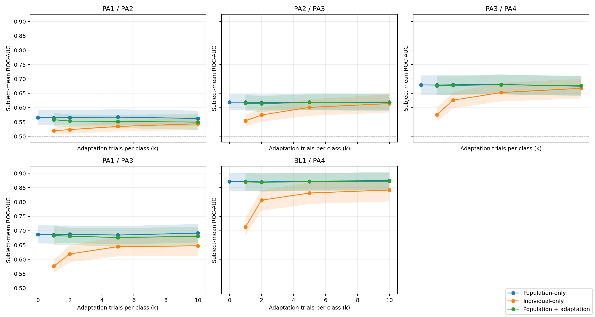
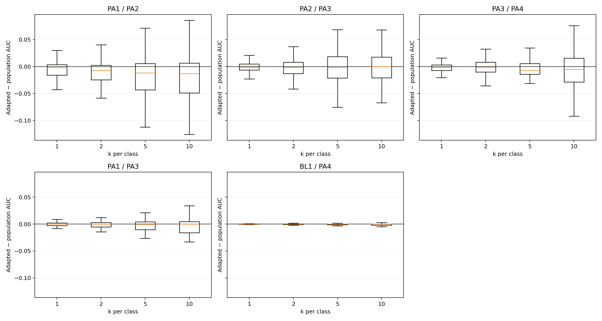

# Phase 9 — Sample-Efficient Subject Adaptation for Pain Recognition

Run date: 2026-10-25

## Executive answer

Population + Adaptation did **not** stably outperform Population-only on matched evaluation trials. At `k=10` labelled trials per class, the mean adapted-minus-population ROC-AUC gain was -0.0128 for PA1/PA2, +0.0016 for PA2/PA3, and +0.0018 for PA3/PA4; every adjacent-pair 95% subject-clustered bootstrap interval included zero except PA1/PA2, whose point estimate remained negative. The wide controls also showed no gain.

The result does not support the hypothesis that a small labelled target-subject set can reliably recover a hidden adjacent-boundary signal with this fixed low-dimensional physiological representation and lightweight residual adapter. PA1/PA2 remained particularly difficult. PA2/PA3 and PA3/PA4 showed weak late positive point estimates, but these were much smaller than the pre-specified practical threshold of 0.02 AUC and were not statistically stable.

These labels are subject-calibrated experimental heat-stimulus levels, not trial-level subjective pain ratings. BL1 is a post-PA1 recovery-period segment, not an independent neutral resting baseline; BL1/PA4 is therefore a protocol contrast rather than a pure rest-versus-pain comparison.

## Protocol

- Data: BioVid Part A physiological feature table only; no facial/video data.
- Pairs: PA1/PA2, PA2/PA3, PA3/PA4, PA1/PA3, and BL1/PA4.
- Outer evaluation: exact Phase 3 subject-independent fold assignments. The population model and its imputer/scaler never used any subject in the held-out outer fold.
- Features: the fixed Phase 6/8 five-feature set (four EDA features and one trapezius EMG trend feature). No Phase 9 feature search was performed.
- Sample budgets: `k ∈ {0,1,2,5,10}` trials per class, with 10 deterministic repeated samples for each nonzero k.
- Evaluation: adaptation trials were removed from the target subject's evaluation set. All three methods used identical evaluation trials for each subject × pair × k × repeat.
- Population-only: L2 Logistic Regression trained on the outer-fold training subjects.
- Individual-only: L2 Logistic Regression fitted from scratch on the `2k` target-subject adaptation trials. Its median imputer and scaler were fitted only on those trials.
- Population + Adaptation: the population logit was held fixed and a strongly L2-regularized target-subject residual intercept plus five feature coefficients were fitted on adaptation trials. This can alter the feature-space decision boundary.
- Phase 6 distinction: Phase 6 fitted only a one-dimensional Logistic mapping from population score to label. Phase 9 is therefore feature-level residual adaptation, not a repeat of score calibration.
- Uncertainty: repeats were averaged within subject first. The 95% CIs then resampled subjects as clusters (2,000 resamples); repeated samples were not treated as independent observations.
- Hyperparameters, including residual penalty 10 and individual-model `C=0.1`, were fixed before evaluation. Target evaluation labels were never used for preprocessing, tuning, or method selection.

The population model excludes the entire held-out Phase 3 fold, not merely the target subject. This exactly preserves the established grouped protocol, though it provides slightly less population data than LOSO.

## Performance comparison

The table reports subject-mean ROC-AUC. The `k=0` population value uses all 40 target trials; at `k=10`, every method uses the same remaining 20 trials.

| pair | population k=0 | population k=10 | individual k=10 | adapted k=10 | adapted − population, 95% CI | negative-transfer subjects |
|---|---:|---:|---:|---:|---:|---:|
| PA1/PA2 | 0.566 | 0.562 | 0.544 | 0.549 | -0.0128 [-0.0253, 0.0010] | 66.7% |
| PA2/PA3 | 0.619 | 0.618 | 0.614 | 0.619 | +0.0016 [-0.0118, 0.0159] | 49.4% |
| PA3/PA4 | 0.679 | 0.674 | 0.667 | 0.676 | +0.0018 [-0.0118, 0.0165] | 62.1% |
| PA1/PA3 | 0.687 | 0.691 | 0.647 | 0.680 | -0.0110 [-0.0218, -0.0014] | 50.6% |
| BL1/PA4 | 0.871 | 0.875 | 0.842 | 0.872 | -0.0027 [-0.0055, -0.0002] | 34.5% |

The population k=0 versus k=10 differences are sampling effects: the latter excludes the randomly selected adaptation trials. The causal adaptation comparison is adapted versus population at the same k, not either value versus k=0.

Balanced accuracy occasionally moved without a corresponding AUC improvement. At k=10, adapted-minus-population balanced-accuracy gains were -0.005 for PA1/PA2, +0.011 for PA2/PA3, +0.030 for PA3/PA4, +0.012 for PA1/PA3, and +0.007 for BL1/PA4. PA3/PA4 and BL1/PA4 had CIs above zero for this threshold-dependent metric, while AUC CIs crossed zero. This is consistent with threshold adjustment rather than a reliable improvement in ranking/discrimination, so ROC-AUC remains the primary endpoint.

## Sample efficiency

### PA1/PA2

Adaptation was negative at every sampled budget: -0.0065, -0.0126, -0.0150, and -0.0128 AUC for k=1, 2, 5, and 10. At k=10 only 32.2% of subjects improved, while 66.7% showed negative transfer. Increasing labelled data did not rescue this boundary.

### PA2/PA3

Mean gains moved from -0.0038 (k=1) and -0.0047 (k=2) to -0.0002 (k=5) and +0.0016 (k=10). This resembles saturation near zero, not a practically useful learning curve. At k=10, 50.6% of subjects improved and 49.4% worsened; only 24.1% reached a gain of at least 0.02 AUC.

### PA3/PA4

Mean gains were -0.0027, -0.0021, -0.0011, and +0.0018 from k=1 through k=10. Despite the slightly positive endpoint, 62.1% of subject-level mean gains were negative because gains were skewed by a smaller set of larger positive responses. The cluster CI included zero.

### Wide controls

PA1/PA3 adaptation became increasingly negative, reaching -0.0110 at k=10 with a CI below zero. BL1/PA4 remained essentially unchanged but slightly negative. This shows that lack of benefit is not unique to adjacent pairs. Wide-pair Individual-only models did improve strongly with k, but they still did not catch the population model.



## Individual-only and the within/cross gap

Individual-only ROC-AUC rose monotonically with k for every pair: for example, PA2/PA3 increased from 0.554 at k=1 to 0.614 at k=10, and BL1/PA4 from 0.713 to 0.842. This confirms the Phase 8 concern that very small personalized training sets are sample-limited.

However, at k=10 Individual-only remained below matched Population-only for all pair means. The individual-minus-population gap was -0.0185 for PA1/PA2, -0.0038 for PA2/PA3, -0.0073 for PA3/PA4, -0.0442 for PA1/PA3, and -0.0334 for BL1/PA4. Only PA1/PA3 and BL1/PA4 had intervals entirely below zero; the adjacent-pair intervals were too wide to establish equivalence.

Population + Adaptation exceeded Individual-only by +0.0332 AUC for PA1/PA3 and +0.0308 for BL1/PA4 at k=10, with CIs above zero. That benefit reflects useful population prior information compared with fitting a personal model from only 20 trials. It does **not** demonstrate adaptation value, because the adapted model still failed to outperform Population-only.

Thus, the extra target labels clearly help a from-scratch individual learner, but the added residual capacity does not produce net discrimination gains once the population model is already available. The data do not support attributing an improvement to individual information beyond the population prior.

## Subject heterogeneity and negative transfer

Adaptation effects varied substantially by subject, especially at larger k. PA1/PA2 had the clearest adverse pattern; PA2/PA3 was closest to an even split between benefit and harm. The practical-gain rate (gain ≥0.02 AUC) at k=10 was only 18.4% for PA1/PA2, 24.1% for PA2/PA3, 21.8% for PA3/PA4, 14.9% for PA1/PA3, and 3.4% for BL1/PA4.



These patterns do not justify selecting “adaptable subjects” using the same evaluation outcomes. Such selection would leak outcome information and exaggerate utility. The subject-level table is retained for hypothesis generation only.

## Relation to Phase 6 physiological consistency

Two pre-existing Phase 6 subject summaries were tested against adaptation gain: median absolute feature monotonicity and sign-reversal rate. Across all pair × k tests, no association survived Benjamini–Hochberg correction. At k=10, absolute correlations ranged from 0.029 to 0.208 for median absolute monotonicity and from 0.043 to 0.098 for reversal rate.

The strongest uncorrected k=10 association was PA2/PA3 median absolute monotonicity versus gain (`ρ=-0.208`, nominal `p=0.059`, BH-adjusted `p=0.395`; 83 complete subjects), which is neither statistically stable nor in the expected positive direction. Four subjects lacked a finite median monotonicity summary and were excluded pairwise from that predictor only.

This analysis provides no evidence that Phase 6 physiological consistency identifies who will benefit from the current adapter. It is exploratory and non-independent because Phase 6 and Phase 9 use the same cohort and overlapping features.

## Comparison with Phase 6 and Phase 8

- Phase 6 score calibration did not rescue PA1/PA2 or PA2/PA3. Phase 9 allowed subject-specific feature-level boundary changes and reached the same substantive conclusion.
- Phase 8 found low within-subject adjacent-pair AUC and warned that its 32-trial personalized training folds were disadvantaged relative to thousands of population trials. Phase 9 directly traces this sample-efficiency curve: Individual-only improves with k, but even 20 labelled trials (`k=10` per class) do not reliably exceed the population prior.
- Phase 9 narrows the explanation: the Phase 6 failure was not merely caused by using a one-dimensional score calibrator. Under the fixed five-feature representation, lightweight feature-level adaptation also fails to recover stable adjacent-level discrimination.
- This still does not prove a physiological information ceiling. The short Part A window, fixed preselected features, experimental stimulus labels, and limited maximum k constrain the inference.

## Decision and limitations

The pre-specified decision standard is not met: Population + Adaptation is not stably better than Population-only on matched evaluation trials. No more complex adapter was introduced after observing this result.

Key limitations are:

- Maximum k=10 leaves only 10 evaluation trials per class, so individual AUCs are noisy even after repeat averaging.
- Feature selection originated in earlier analyses of the same 87 subjects. The outer-fold model fitting is leakage-safe, but this is exploratory rather than an independent confirmatory validation.
- The residual penalty was fixed rather than nested-tuned. This prevents target-evaluation leakage but means the study evaluates one conservative low-parameter adapter, not every possible adaptation algorithm.
- Repeats reduce dependence on a single adaptation draw but do not create new subjects or trials. Subject-clustered intervals address the principal population dependence, conditional on the fixed outer folds and fitted models.
- Part A provides short physiological clips. Individual response latency and truncated recovery may limit observability, especially for EDA.
- BL1 is a post-PA1 recovery segment and differs from PA4 in both stimulus level and protocol phase.
- Results concern prediction of calibrated heat-stimulus categories, not clinical pain, causal physiology, or universal biomarkers.

## Reproducibility

Run from the repository root:

```bash
python -m src.models.run_subject_adaptation \
  --root . \
  --config configs/subject_adaptation.yaml \
  --output-dir experiments/subject_adaptation
```

`experiments/subject_adaptation/config.json` records the random seed, dependency versions, full configuration, input paths and SHA-256 hashes, command, outer-fold protocol, subject count, and trial count.

Main machine-readable outputs:

- `trial_predictions.csv.gz`: matched evaluation predictions for every method and repeat;
- `adaptation_split_manifest.csv`: deterministic split seeds, counts, and adaptation/evaluation sample-set hashes;
- `subject_repeat_metrics.csv`: the first-stage subject × repeat estimates;
- `paired_method_comparisons.csv`: matched method contrasts;
- `performance_summary.csv`: subject-clustered performance summaries;
- `adaptation_gain_summary.csv`: subject-clustered gain summaries;
- `subject_adaptation_gains.csv`: repeat-averaged subject effects and negative-transfer flags;
- `improvement_negative_transfer_rates.csv`: pair × k benefit/harm rates;
- `phase6_consistency_gain_associations.csv`: exploratory consistency associations with multiplicity correction.

