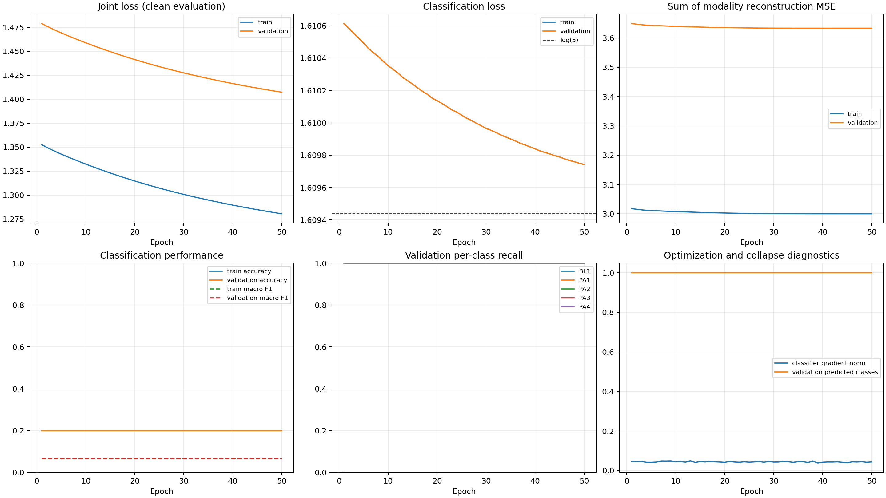

# Thiam et al. (2021) Fold 1 convergence and overfitting diagnostic

Run completed: 2026-10-26T07:35:21.910283+00:00

## Decision

The current adapted Thiam 2021 model did **not** pass the pre-registered convergence gate. Training stopped at epoch 50 because both the fit set and the subject-disjoint validation set had predicted only `PA2` for 50 consecutive epochs. The outer-test labels were not evaluated, no test metrics or test confusion matrix were produced, and no additional fold, seed, or model experiment was started.

This run shows persistent single-class collapse under the current adapted implementation and paper-derived training settings. It does not show classical overfitting: the fit set itself was not learned, so there was no train-versus-validation performance gap from which to infer cross-subject overfitting. A five-fold run is not recommended until the objective and optimization interpretation has been reviewed in a separately authorized experiment.

## Protocol and leakage controls

- Outer fold: Phase 3 fold 1, unchanged.
- Fit: 42 subjects / 4,200 trials.
- Subject-disjoint validation: 10 subjects / 1,000 trials.
- Calibration reserve, held out and unused: 18 subjects / 1,800 trials.
- Outer test, held out and unevaluated: 17 subjects / 1,700 trials.
- Per-modality scalar standardization was fitted on the 42 fit subjects only.
- Checkpoint selection used validation joint loss only. Neither outer-test labels nor outer-test predictions were accessed during training or model selection.
- Seed: `20261025`; batch size: 100; Adam learning rate: `1e-5`; configured maximum: 100 epochs.
- Pre-registered stop rules: validation-loss patience 15 and persistent-collapse check from epoch 50. The collapse rule fired first.

This remains an **adapted reproduction**: it uses the existing local 4.5 s canonical crop and fit-subject standardization, with no random crop augmentation. The architecture, three modalities, objective weights, optimizer, learning rate, batch size, and fold assignment were not changed for this diagnostic.

## Training outcome

The checkpoint with the lowest validation joint loss was epoch 50. It is retained for diagnosis, but it is not a valid converged classifier checkpoint.

| quantity | initial model | best checkpoint (epoch 50) |
|---|---:|---:|
| fit joint loss | 1.355420 | 1.280616 |
| validation joint loss | 1.481729 | 1.407322 |
| fit classification loss | 1.610651 | 1.609743 |
| validation classification loss | 1.610651 | 1.609743 |
| fit reconstruction-loss sum | 3.020767 | 3.000042 |
| validation reconstruction-loss sum | 3.652315 | 3.633572 |
| fit accuracy | 0.2000 | 0.2000 |
| validation accuracy | 0.2000 | 0.2000 |
| fit macro F1 | 0.0667 | 0.0667 |
| validation macro F1 | 0.0667 | 0.0667 |

For reference, the balanced five-class cross-entropy of uniform probabilities is `ln(5) = 1.609438`. At epoch 50, fit and validation classification loss remained slightly worse than this value. Accuracy and macro F1 were flat for all 50 epochs.

The validation joint loss fell by 0.074407. Decomposing that change using the implemented objective weights:

- weighted L2 contribution fell by 0.070296 (94.5% of the joint-loss decrease);
- weighted reconstruction contribution fell by 0.003748;
- weighted classification contribution fell by 0.000363.

Thus checkpoint selection continued to improve mainly because autoencoder weights shrank, not because class discrimination improved. Early-stopping patience was never exhausted (`epochs_without_improvement_at_stop = 0`); the explicit collapse rule terminated the run.



## Per-class behavior and confusion matrices

At the epoch-50 checkpoint, per-class recall was identical on fit and validation:

| split | BL1 | PA1 | PA2 | PA3 | PA4 | predicted-class distribution |
|---|---:|---:|---:|---:|---:|---|
| fit | 0.0000 | 0.0000 | 1.0000 | 0.0000 | 0.0000 | PA2: 4,200; all others: 0 |
| validation | 0.0000 | 0.0000 | 1.0000 | 0.0000 | 0.0000 | PA2: 1,000; all others: 0 |

Fit confusion matrix (rows=true, columns=predicted; order `BL1 PA1 PA2 PA3 PA4`):

```text
  0  0  840  0  0
  0  0  840  0  0
  0  0  840  0  0
  0  0  840  0  0
  0  0  840  0  0
```

Validation confusion matrix:

```text
  0  0  200  0  0
  0  0  200  0  0
  0  0  200  0  0
  0  0  200  0  0
  0  0  200  0  0
```

There is intentionally no outer-test row or confusion matrix. The pre-registered gate required at least two predicted classes on both fit and validation; it failed because fit predicted one class. Evaluating the test split after that failure would not inform checkpoint selection and would weaken the stated no-test-peeking discipline.

## Gradient, capacity, and failure diagnosis

- Total/trainable parameters: 1,834,742 / 1,834,742.
- Autoencoders: 1,013,233 parameters; multimodal gate: 787,968; classifier: 33,541.
- Mean classifier-head gradient norm across epochs: 0.04403.
- Per-epoch mean classifier-head gradient norm range: 0.03845–0.04838.
- Epoch 1/50 mean classifier-head gradient norm: 0.04553 / 0.04390.
- No NaN or non-finite metric occurred.

The classifier received non-zero gradients throughout, ruling out a detached classification head or a trivially dead backward path. Nevertheless, those updates did not produce multiclass discrimination. The observed status is therefore **optimization/objective failure under the current configuration**, rather than a numerical failure.

Model-capacity insufficiency is not established: parameter count alone cannot prove adequate or inadequate capacity, and the model never fitted the training classes. Cross-subject generalization difficulty is also not established by this run: validation did no worse than fit because both were collapsed. The reconstruction-domain gap (fit sum 3.0000 versus validation 3.6336) is consistent with subject/domain shift, but it cannot be interpreted as classification overfitting while classification remains at chance-collapse behavior.

A plausible diagnostic target is the paper-ambiguous L2 formulation and its interaction with joint-loss checkpointing: the measured joint-loss improvement was overwhelmingly weight shrinkage. This is a hypothesis for a future, explicitly scoped method audit—not a post hoc change made in this run. Other paper ambiguities and local adaptations remain documented in `reports/thiam2021_feasibility_review.md`.

## Device and compute cost

- Device: Apple Silicon MPS (`torch.backends.mps.is_available() = True`).
- Completed epochs: 50; termination reason: `persistent_single_class_collapse`.
- Training plus per-epoch evaluation: 370.05 s (6.17 min).
- Epoch time: 7.24 s mean, 6.51 s minimum, 8.36 s maximum.
- Peak process RSS: 731.1 MB.
- MPS current/driver allocation at final snapshot: 97.2 / 373.5 MB.

The cost is modest enough for five folds, but compute affordability is not a reason to proceed with a classifier that failed its convergence gate.

## Reproducibility record

- Command: `/Library/Frameworks/Python.framework/Versions/3.13/bin/python3 -m src.models.run_thiam2021_fold1_diagnostic --config configs/thiam2021_fold1_diagnostic.yaml`
- Resolved configuration: `experiments/thiam2021_fold1_diagnostic/resolved_config.yaml`.
- Epoch history and crash-safe log: `training_history.csv`, `training_log.jsonl`.
- Split manifest and final fit/validation predictions: `subject_split_manifest.csv`, `fit_predictions.csv`, `validation_predictions.csv`.
- Local checkpoint: `best_model.pt` (git-ignored to avoid committing model binaries).
- Checkpoint SHA-256: `5d8a491d86ab5e2b81ffe4daf26bb721a3bc1f42e378a67e5c164c7278921cb3`.
- Raw-signal collection SHA-256: `b0d460d5e0048070ff832f5572dbf216033b127da59efcccd6bcb17e52e89837`.
- Samples metadata SHA-256: `5e98de3957cc998e18c2d6d65b699ce613a484e0d2a1fb8afaec3f3877ac61fe`.
- Fold assignments SHA-256: `d01b58e80bb8c8cfb36e6c43a02c2b33d19525c9fcc9e41d44407f60af8510a3`.
- Paper PDF SHA-256: `eb00d25c3b59945867532c7ac7a8ff659a80dd348381bca218c4cc4b18893b0c`.
- Configuration SHA-256: `b3ab787b6c83404954246b7720ed408e959fa356e9c2ecfd2e87a891f43e82bf`.
- Dependency versions and platform details are recorded in `run_manifest.json`.

The initial launch encountered an MPS-only diagnostic issue while converting gradient tensors directly to float64 and exited before any optimizer step. The collector was changed to cast to float32 on MPS before CPU float64 accumulation, covered by a unit test, and the same seed/configuration was restarted from a fresh model. This did not alter the model, data, loss, optimizer, or experimental protocol.

## Recommendation and scope

Do not proceed to five folds or multiple seeds with the current objective implementation. Before any formal reproduction claim, perform a bounded method audit of paper-ambiguous loss regularization, loss scaling, and the intended training schedule, then pre-register any correction as a new adapted-reproduction configuration. That work was not performed here because this task prohibited repeated trial-and-error tuning.

This negative diagnostic does not modify or weaken the Phase 3–10 results: it only shows that the current adapted deep baseline did not become a usable classifier. The earlier two-epoch smoke result remains an engineering smoke result and is not promoted to thesis evidence.
